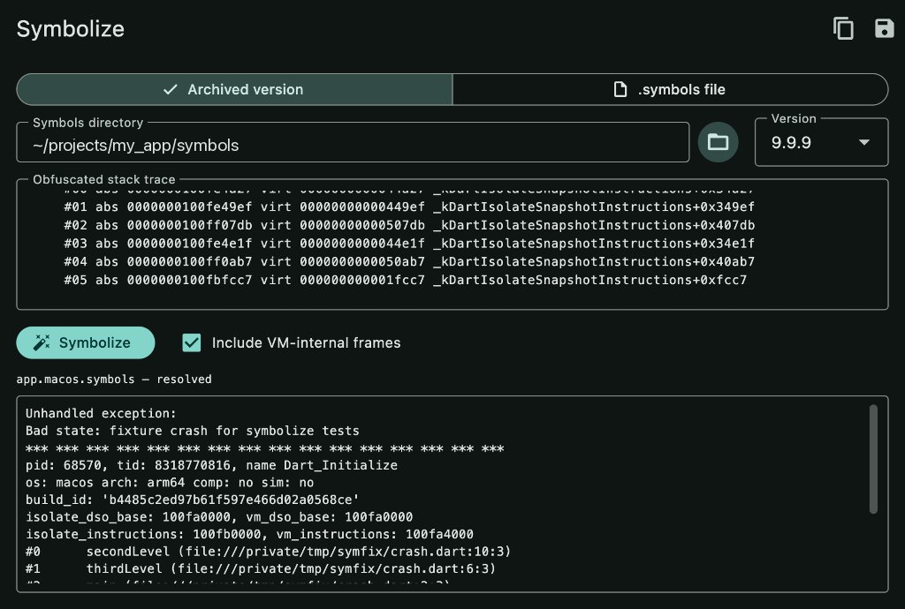

# symbolize

Deobfuscate Dart and Flutter release stack traces.

Obfuscated release builds (`--obfuscate --dwarf-stack-traces`) crash with
hex program counters instead of function names. Decoding needs the matching
`--split-debug-info` symbols file for that exact build — but
`build/symbols/` is gitignored and overwritten every build.

`symbolize` fixes both halves:

- **`symbolize archive`** stashes split-debug-info output under
  `symbols/<version>/` with a manifest (DWARF build ids, git SHA, date).
- **`symbolize decode`** picks the right file automatically — exact match on
  the trace header's `build_id`, else `os:`/`arch:` filename narrowing.

Decoding runs in-process via
[`native_stack_traces`](https://pub.dev/packages/native_stack_traces) — the
same DWARF engine `flutter symbolize` uses. No Flutter SDK needed at decode
time.

Beyond the basics:

- **`symbolize watch`** auto-archives `build/symbols` after every build.
- **`symbolize fetch` / `decode --remote`** pull symbols from a shared
  remote store — any `symbols/` dir is publishable over HTTP via its
  auto-written `index.json`.
- **`symbolize upload`** pushes an archive to Crashlytics or Sentry.
- **`--json`** and **`--source`** on decode — machine-readable reports and
  inline source context.
- **Patch-aware** — each patch/hotfix build has its own `build_id`;
  archive it under its own version label and matching still works.

## Repository layout

| Path | What |
| --- | --- |
| [`packages/symbolize`](packages/symbolize) | The library + CLI, published on pub.dev |
| [`packages/symbolize_app`](packages/symbolize_app) | Flutter desktop app (macOS) |

## Quick start

```sh
dart pub global activate symbolize

# After each release build:
flutter build apk --release --obfuscate --split-debug-info=build/symbols
symbolize archive

# Decode a crash:
symbolize decode -i crash.txt
pbpaste | symbolize decode
```

See [packages/symbolize/README.md](packages/symbolize/README.md) for the full
CLI and library reference.

## Desktop app

```sh
cd packages/symbolize_app
flutter run -d macos
```

The app is built for zero-effort decoding:

- **Paste → decoded.** Dropping a trace into the field (or pasting it)
  decodes automatically — no button press needed.
- **One tap, zero typing.** With an empty field, the Symbolize button reads
  the clipboard directly.
- **Version selects itself.** A `build_id` index across `symbols/*/`
  resolves the archived version that produced the crash — the dropdown is
  only a manual override.
- **Drag anything in.** Drop a `.symbols` file, a `.txt` trace, or a
  symbols folder straight onto the window.
- **One-tap archive.** The app-bar import button copies `build/symbols`
  into `symbols/<version>/` and re-indexes.

`build_id` mismatches are surfaced as warnings instead of plausible-looking
garbage, and sibling `.map.json` files restore obfuscated names in
name-level traces.



## Development

```sh
cd packages/symbolize && dart pub get && dart test
cd packages/symbolize_app && flutter pub get && flutter test
```

## License

MIT — see [LICENSE](LICENSE).
